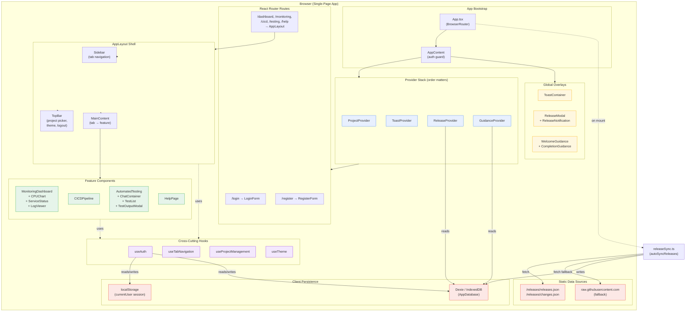
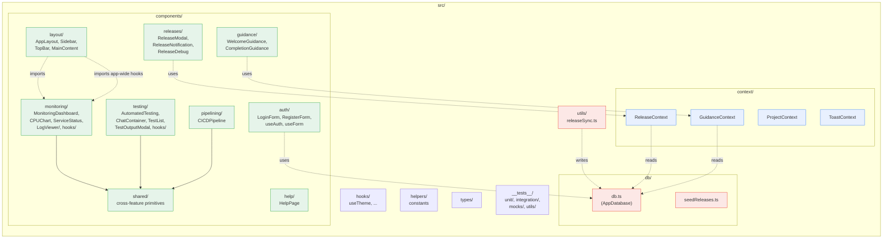

# Component Diagram — Poly Micro Manager (Frontend Demo)

> Confluence page describing the runtime component structure of the SPA. The diagrams below are written in **Mermaid** — Confluence Cloud renders Mermaid natively from `mermaid` code fences. If your space uses Server/Data Center, install the *Mermaid Diagrams for Confluence* macro or paste the code into a Markdown macro.

## 1. High-Level Component Diagram



## 2. Container View

| Container         | Type                  | Responsibility                                                                 |
| ----------------- | --------------------- | ------------------------------------------------------------------------------ |
| **App**           | React root            | Mounts `BrowserRouter`, kicks off `autoSyncReleases()` on mount.               |
| **AppContent**    | Auth guard            | Watches `useAuth().isAuthenticated`; redirects to `/login` when missing.       |
| **Provider Stack**| React Context layer   | `ProjectProvider → ToastProvider → ReleaseProvider → GuidanceProvider`.        |
| **AppLayout**     | Shell                 | Renders `Sidebar`, `TopBar`, `MainContent` for all authenticated routes.       |
| **MainContent**   | Tab dispatcher        | Maps `TabName` → feature component (`MonitoringDashboard`, `CICDPipeline`, etc.). |
| **Feature comps** | Domain UI             | Self-contained per-feature trees with their own `hooks/`, `constants.ts`.      |
| **Global overlays**| Sibling renderers    | `ToastContainer`, `ReleaseModal`, `WelcomeGuidance`, `CompletionGuidance`.     |
| **AppDatabase**   | Dexie / IndexedDB     | Tables: `users`, `releases`, `userAcknowledgments`.                            |
| **localStorage**  | Browser storage       | Holds `currentUser` for session persistence between reloads.                   |

## 3. Module / Feature Map



> Note: `useTabNavigation`, `useProjectManagement`, and `useAuthManagement` live under `components/monitoring/hooks/` even though `AppLayout` consumes them as app-wide hooks. This is intentional and documented in `CLAUDE.md`.

## 4. Key Interfaces & Contracts

| Boundary                         | Direction          | Contract                                                                 |
| -------------------------------- | ------------------ | ------------------------------------------------------------------------ |
| `useAuth` ↔ `localStorage`       | read / write       | Key `currentUser`; value is the JSON-serialized `User` from Dexie.       |
| `useAuth` ↔ Dexie `users` table  | read / write       | Lookup by `username`; plaintext `password` comparison; insert on register. |
| `releaseSync` ↔ `releases.json`  | read (fetch)       | Schema: `{ releases: [{ version, releaseDate, title, description, changes[] }] }`. |
| `releaseSync` ↔ Dexie `releases` | write              | Inserts new versions; toggles `isLatest` (1/0) by semver-descending sort. |
| `ReleaseProvider` ↔ `releases`   | read               | Drives `ReleaseModal` and `ReleaseNotification`.                         |
| `GuidanceProvider` ↔ `userAcknowledgments` | read / write | Tracks per-user release acknowledgements and onboarding state.        |
| `MainContent` ↔ feature comps    | render contract    | Passes `selectedProject.id` and an `initialServiceName` getter.          |

## 5. External Dependencies (runtime)

- **React 18 / React Router 6** — UI rendering and routing.
- **Dexie 3** — IndexedDB persistence.
- **Recharts** — CPU / memory time-series charts in `monitoring/`.
- **Lucide React** — icon set.
- **React Toastify** — global toast container.
- **GitHub raw content** — fallback source for `releases.json` when the local fetch returns no entries.

## 6. Deployment Topology

```mermaid
flowchart LR
  Dev["Developer browser"] -->|HTTP| Static["Static hosting<br/>(GitHub Pages /<br/>any static CDN)"]
  Static -->|serves| Bundle["Vite production bundle<br/>(JS, CSS, assets)"]
  Bundle -->|loads| Browser["Browser SPA"]
  Browser -->|persists| IDB[("IndexedDB<br/>AppDatabase")]
  Browser -->|persists| LS[("localStorage<br/>currentUser")]
  Browser -->|fetch (optional)| GH["raw.githubusercontent.com<br/>(release notes fallback)"]
```

There is no application server in this repo; all runtime logic executes in the user's browser.
