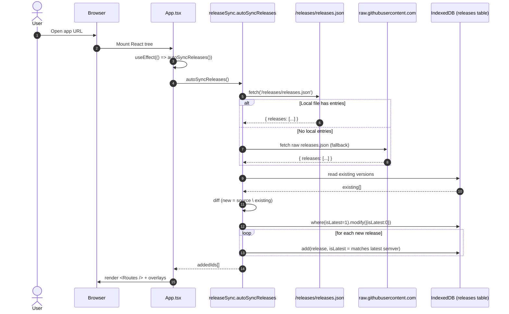
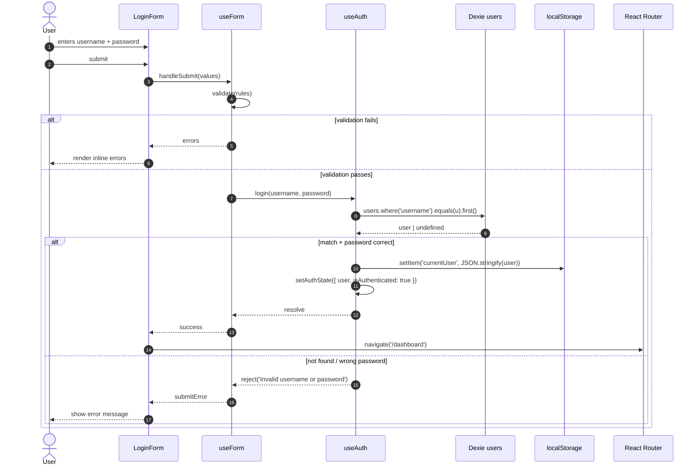
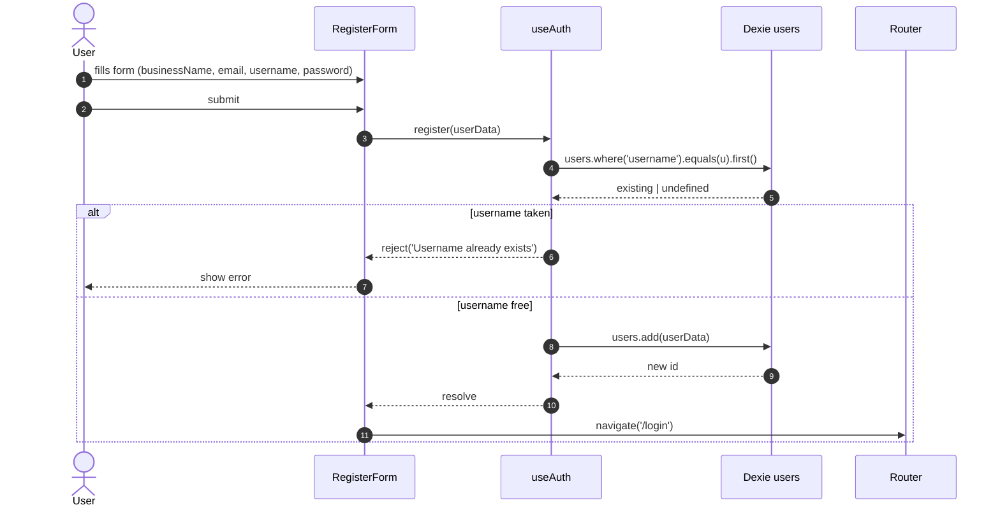
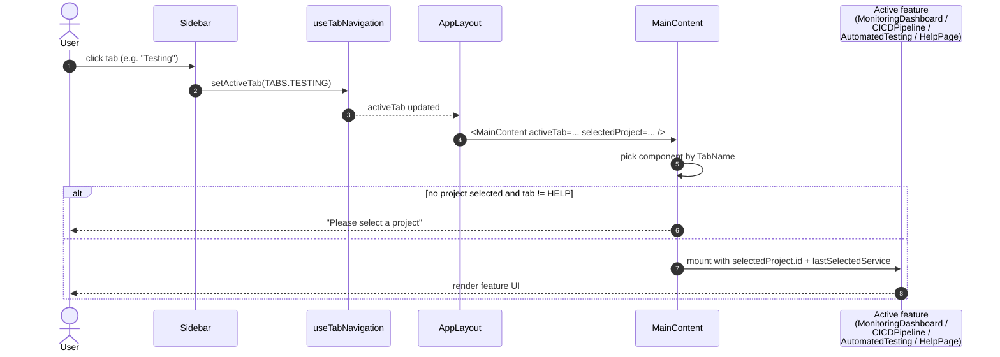
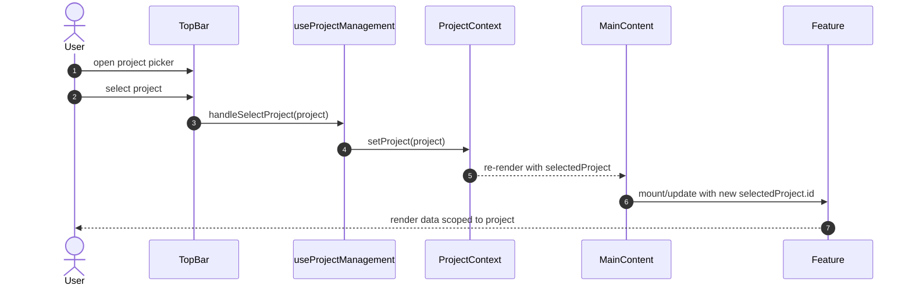
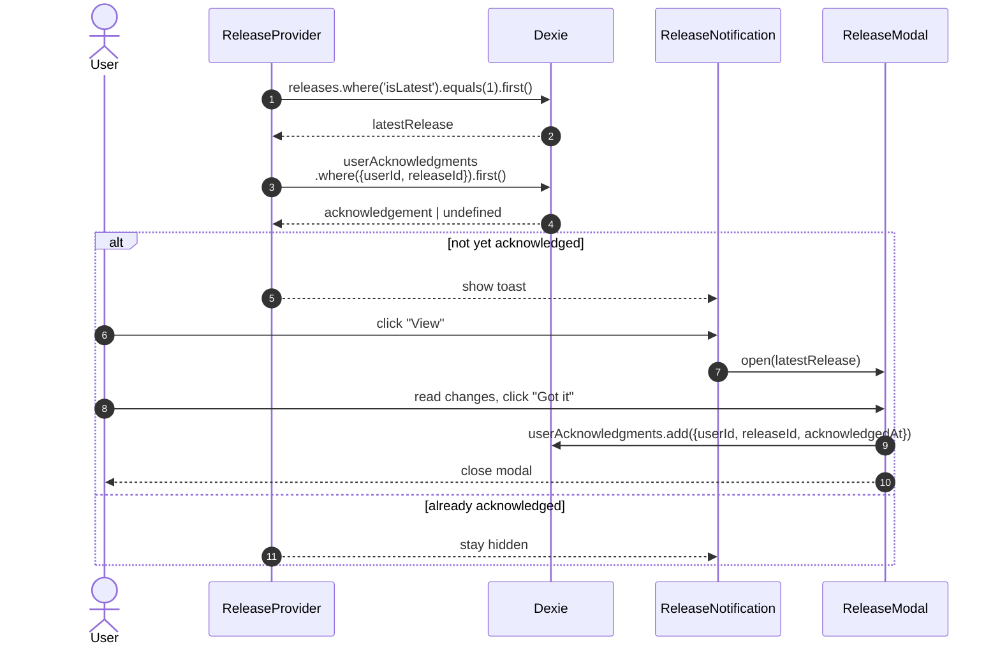
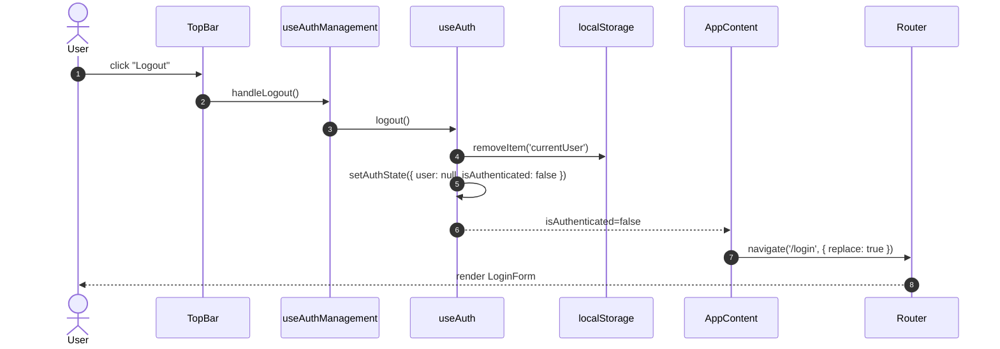
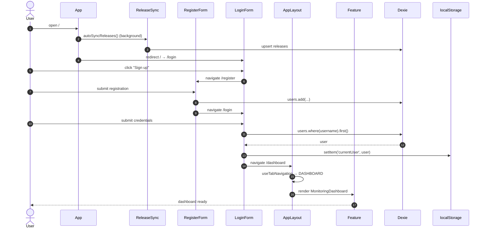

# Sequence Diagrams — Poly Micro Manager (Frontend Demo)

> Confluence page collecting the principal runtime sequences of the SPA. Diagrams use **Mermaid** sequence syntax — Confluence Cloud renders these natively from `mermaid` code fences. On Server/Data Center, install the *Mermaid Diagrams for Confluence* macro.

---

## 1. Application Bootstrap & Release Sync

Triggered automatically on first render of `App.tsx`.

**Notes**

- The fallback path is hard-coded to `siriknikita/poly-micro-frontend-demo/main/releases/releases.json` in `releaseSync.ts`.
- `isLatest` uses `1` / `0` (not booleans) to satisfy Dexie indexing.

---

## 2. Login Flow

**Caveats**

- Passwords are compared as plaintext against the Dexie record. Demo-only.
- `useAuth` listens to `storage` events so a login in another tab propagates to all open tabs.

---

## 3. Registration Flow

---

## 4. Authenticated Tab Navigation

`AppLayout` is the same component for `/dashboard`, `/monitoring`, `/cicd`, `/testing`, and `/help`. The active feature is selected by `useTabNavigation`, not by route path.

**Side effects in `AppLayout`**

- A `sessionStorage` flag `forceTestingTab` (set by guidance navigation) forces `activeTab = TESTING` and is then cleared.
- A `?guidance=true` query param triggers `refreshAuthState()` and is stripped from the URL via `history.replaceState`.

---

## 5. Project Selection

---

## 6. Release Notification & Acknowledgement

Triggered after login when the synced "latest" release has not yet been acknowledged by the current user.

---

## 7. Logout

---

## 8. End-to-End: New User → Dashboard

A consolidated happy-path covering registration through first feature view.

---

## 9. Cross-Cutting Notes

- **No backend HTTP** in production runtime — only `fetch` calls hit the **static** `releases.json` (and optionally GitHub raw as a fallback). Tests use **MSW** to intercept any HTTP traffic.
- **State propagation** between contexts is synchronous within the React render cycle; cross-tab synchronisation relies on `localStorage` `storage` events handled inside `useAuth`.
- **No tokens / no refresh flow.** Session = presence of the `currentUser` JSON in `localStorage`.
